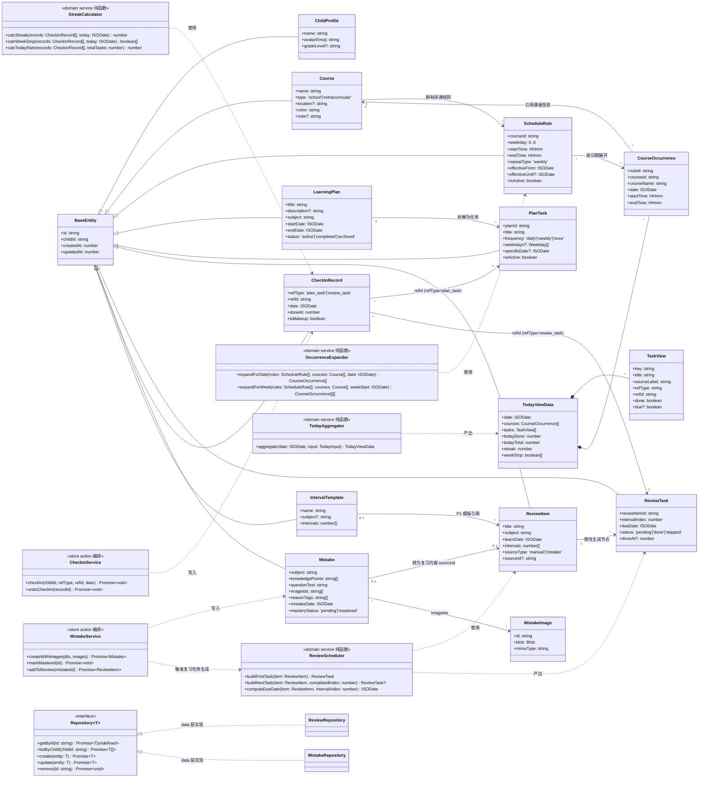
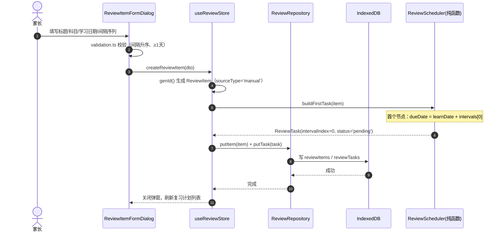
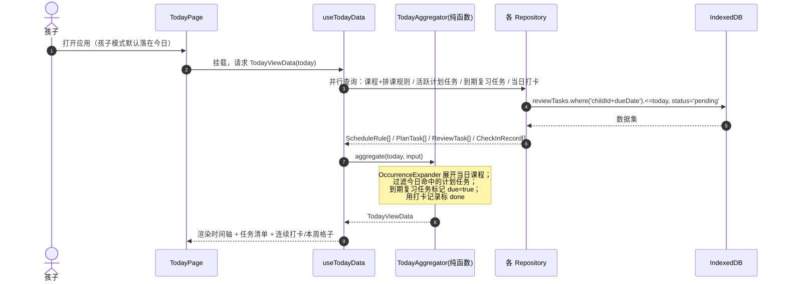
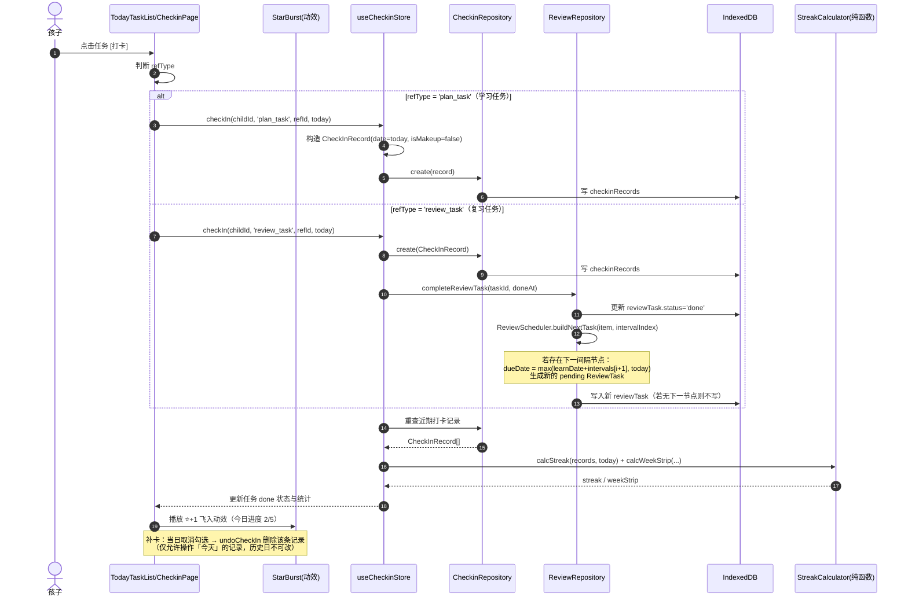
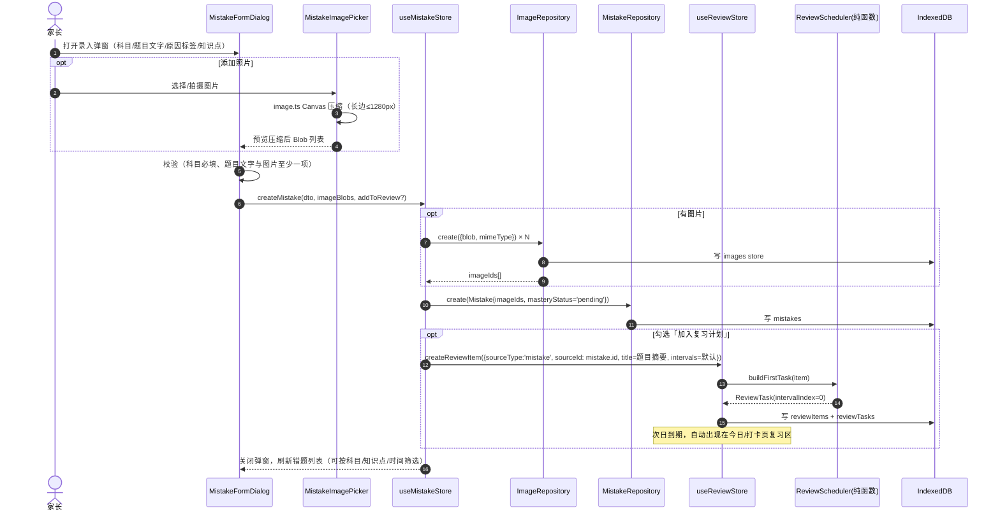
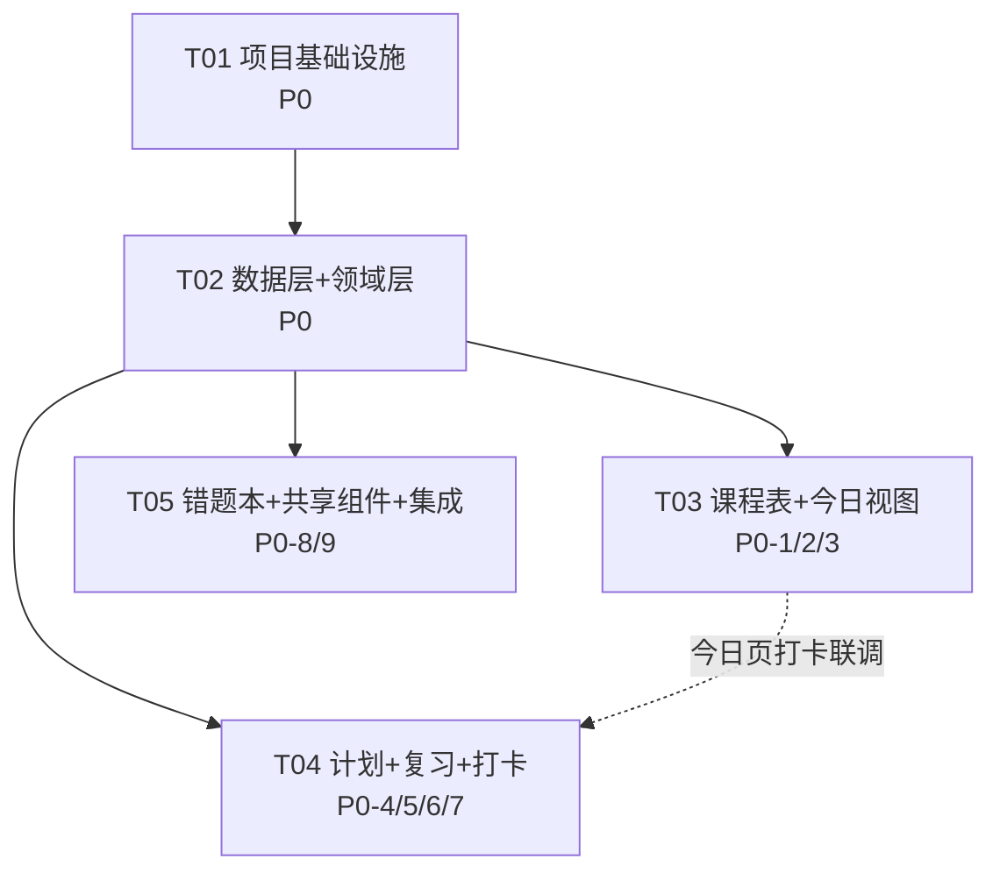

# ARCHITECTURE：小朋友课程表与学习管理（kid_course_schedule）系统架构设计与任务分解

| 项目信息 | 内容 |
| --- | --- |
| 文档版本 | v0.1 |
| 文档角色 | 系统架构设计 + 任务分解（不含业务实现代码） |
| 上游输入 | `docs/PRD.md`（v0.1） |
| 技术栈（已定） | Vite + React 18 + TypeScript + MUI + Tailwind CSS |
| 平台 | Web 响应式单页应用，移动端优先 |
| 存储 | 本地优先（IndexedDB，图片存 Blob），数据层抽象 Repository 接口，预留云同步 |
| 账号体系 | 无（P2 预留），家长/孩子模式为界面内切换 |

> 标注「可调整」的技术决策均可在实现阶段替换，不影响整体分层。

---

## 1. 实现方案与框架选型

### 1.1 核心技术挑战分析

| # | 挑战 | 说明 | 应对策略 |
| --- | --- | --- | --- |
| C1 | 周期重复课程的展开 | 「每周六 9:00-10:30 钢琴课」需在任意日期的周视图中正确渲染 | 领域层 `occurrence` 纯函数：由 `ScheduleRule` + 日期 → 当日课程实例（Occurrence），不落库、按需计算 |
| C2 | 遗忘曲线任务的生成与推进 | 间隔序列可自定义（P1-2），若一次性生成全部复习任务，后续改间隔会作废历史数据 | **惰性生成**：录入学习内容时只生成第 1 个复习任务；每完成一个节点，按「已完成次数」查下一个间隔再生成下一个任务 |
| C3 | 今日视图的聚合 | 今日课程 + 学习计划任务 + 到期复习任务 + 打卡状态来自 4 类数据 | 领域层 `TodayAggregator` 统一聚合，页面只消费聚合结果（`TodayViewData`） |
| C4 | 连续打卡天数的计算 | 补卡（仅限当天）、跨日切换、当天无任务等边界 | 领域层 `streak` 纯函数，基于 `CheckInRecord` 按日期聚合计算，规则见「共享知识」 |
| C5 | 图片 Blob 的本地存储 | 错题照片直接存 IndexedDB 需处理对象存取与体积 | 图片独立 `images` store 存 `{ id, blob, mimeType }`，错题只存 `imageIds`；录入时前端压缩（Canvas，长边 ≤1280px） |
| C6 | 家长/孩子双模式 | 同一设备两种操作权限与默认落点 | `useAppStore` 全局 UI 状态（localStorage 持久化），孩子模式隐藏编辑入口、默认落在「今日」 |

### 1.2 整体架构风格：Feature-Based 分层架构

```
┌─────────────────────────────────────────────────────────┐
│  app 层        路由 / 全局布局 / 主题 / Provider          │
├─────────────────────────────────────────────────────────┤
│  features 层   today │ schedule │ plans │ checkin │ mistakes │
│                （页面 + 业务组件 + 数据 Hook）             │
├─────────────────────────────────────────────────────────┤
│  stores 层     zustand 状态仓库（按领域拆分）              │
├─────────────────────────────────────────────────────────┤
│  domain 层     领域模型 / 复习调度 / 打卡连击 / 排课展开    │
│                （纯函数，无副作用，可单测）                 │
├─────────────────────────────────────────────────────────┤
│  data 层       Repository 接口 + IndexedDB 实现            │
│                （未来可替换为 CloudRepository 实现云同步）  │
├─────────────────────────────────────────────────────────┤
│  core 层       常量 / 日期 / ID / 校验 工具                │
└─────────────────────────────────────────────────────────┘
```

- **依赖方向单向向下**：features → stores → domain + data；domain 不依赖任何上层。
- **组件永不直接访问 IndexedDB**：UI → Hook（或 Store action）→ Repository → DB。
- 模式参考：MVI（单向数据流：UI 事件 → Store action → 持久化 → Store 更新 → UI 重渲染）。

### 1.3 框架与关键库选择（含理由）

| 类别 | 选择 | 版本 | 理由 |
| --- | --- | --- | --- |
| 构建 | Vite | ^5.2 | 官方默认决策；冷启动快、TS 开箱即用 |
| UI 框架 | React + TypeScript | ^18.3 / ^5.4 | 官方默认决策；TS 保证领域模型类型安全 |
| 组件库 | MUI（@mui/material + icons） | ^5.15 | PRD 指定；表单控件（Dialog/Select/TextField/Checkbox）成熟，儿童主题可通过 createTheme 定制 |
| 原子样式 | Tailwind CSS | ^3.4 | PRD 指定；与 MUI 共存，用于布局间距/响应式工具类，组件视觉以 MUI 为主 |
| 状态管理 | **Zustand** | ^4.5 | 本地数据为主的中小型应用，Redux 过重；无 Provider 嵌套、TS 推导友好、支持 persist 中间件（存 UI 偏好）。「可调整」 |
| 本地存储 | **idb** | ^8.0 | IndexedDB 的 Promise 封装，体积极小（~1KB）；无需 Dexie 的查询语法糖，Repository 层已隔离，后续可换 |
| 日期 | **date-fns** | ^3.6 | 函数式、按需 tree-shaking；`format`/`addDays`/`startOfWeek`(weekStartsOn:1) 满足全部需求，不引入 moment 体积 |
| 路由 | react-router-dom | ^6.23 | 5 个页签 + 详情/弹窗路由，标准选择 |
| ID | nanoid | ^5.0 | 短、URL 安全、无需配置；所有实体主键统一由此生成 |
| P2 预留 | jspdf / tesseract.js | 不安装 | 错题导出 PDF、OCR 拍照识别；仅在实现 P2 时引入 |

### 1.4 状态管理方案（详细）

| 状态 | 存放位置 | 说明 |
| --- | --- | --- |
| 当前孩子、家长/孩子模式、主题偏好 | `useAppStore` + localStorage persist | 首发单孩子固定一条档案，但全部读写都带 `childId` |
| 课程/排课规则、计划、复习、打卡、错题的业务数据 | 各 feature 的 zustand store | Store action 内调用 Repository 持久化，成功后再更新内存状态 |
| 列表筛选条件、弹窗开关 | 组件本地 useState | 不进全局 |
| 服务端缓存/失效 | 不需要 | 无后端；每次增删改后由 store action 手动刷新对应切片 |

### 1.5 数据库（IndexedDB）设计

单库 `kid_course_schedule`，版本 1，共 10 个 object store：

| Store | 主键 | 索引 | 说明 |
| --- | --- | --- | --- |
| children | id | — | 孩子档案（P1 多孩子；首发自动创建一条默认档案） |
| courses | id | by-child(childId) | 课程定义（名称/类型/颜色/地点） |
| scheduleRules | id | by-child(childId), by-course(courseId), by-weekday(weekday) | 排课规则（每周几 + 时段 + 生效区间） |
| learningPlans | id | by-child(childId), by-status(status) | 学习计划 |
| planTasks | id | by-plan(planId), by-child-date(childId+date), by-child-weekday(childId+weekday) | 计划拆解的任务 |
| reviewItems | id | by-child(childId), by-source(sourceId) | 学习内容（复习对象） |
| reviewTasks | id | by-child-due(childId+dueDate), by-item(reviewItemId), by-status(status) | 复习任务（惰性生成） |
| checkinRecords | id | by-child-date(childId+date), by-ref(refType+refId) | 打卡记录（一天一任务一条） |
| mistakes | id | by-child-date(childId+mistakeDate), by-subject(subject) | 错题（存 imageIds） |
| images | id | — | 图片 Blob + mimeType |
| intervalTemplates | id | by-child(childId) | 复习间隔模板（P1） |

---

## 2. 文件列表及相对路径

```
courseschedule/
├─ index.html                        # SPA 入口，移动端 viewport meta
├─ package.json                      # 依赖声明（见第 6 节）
├─ vite.config.ts                    # Vite 配置（别名 @/ → src/）
├─ tsconfig.json                     # TS 严格模式 + 路径别名
├─ tailwind.config.ts                # Tailwind 内容扫描 + 儿童友好色板扩展
├─ postcss.config.js                 # Tailwind 所需 PostCSS 插件链
├─ eslint.config.js                  # ESLint 平面配置（react + ts）
├─ public/
│  └─ favicon.svg                    # 站点图标
└─ src/
   ├─ main.tsx                       # ReactDOM 挂载点
   ├─ App.tsx                        # 根组件（组合 Provider + 路由）
   ├─ index.css                      # Tailwind 指令 + 全局样式（滚动条/字体）
   ├─ app/
   │  ├─ providers.tsx               # ThemeProvider + CssBaseline + RouterProvider 组合
   │  ├─ theme.ts                    # MUI 主题（圆角/色板/字号，6-12 岁友好）
   │  ├─ routes.tsx                  # 路由表：/today /schedule /plans /checkin /mistakes
   │  └─ AppLayout.tsx               # 顶部标题栏 + 5 页签导航 + 家长/孩子模式切换
   ├─ core/
   │  ├─ constants.ts                # 默认间隔[1,2,4,7,15]、错误原因标签、颜色标签、科目列表
   │  └─ utils/
   │     ├─ date.ts                  # toISODate/getWeekday/ HH:mm 解析/周一起始工具
   │     ├─ id.ts                    # nanoid 封装 genId()
   │     ├─ validation.ts            # 表单校验（必填、时间先后、日期区间）
   │     └─ image.ts                 # 图片压缩（Canvas 长边≤1280）+ Blob 转换
   ├─ domain/
   │  ├─ models.ts                   # 全部领域模型 TS 接口（见第 3 节）
   │  ├─ review/
   │  │  ├─ intervals.ts             # 间隔序列校验/归一化（升序去重、≥1 天）
   │  │  └─ reviewScheduler.ts       # 惰性生成/推进复习任务（纯函数）
   │  ├─ checkin/
   │  │  └─ streak.ts                # 连续打卡天数、本周打卡格子、完成率（纯函数）
   │  ├─ schedule/
   │  │  └─ occurrence.ts            # ScheduleRule + 日期 → 当日课程实例（纯函数）
   │  └─ today/
   │     └─ todayAggregator.ts       # 课程实例+计划任务+到期复习+打卡状态 → TodayViewData
   ├─ data/
   │  ├─ db.ts                       # idb 打开/升级/种子（默认孩子档案+默认间隔模板）
   │  ├─ repositories/
   │  │  ├─ base.ts                  # Repository<T> 接口 + IndexedDB 通用实现基类
   │  │  ├─ childRepository.ts
   │  │  ├─ courseRepository.ts
   │  │  ├─ scheduleRuleRepository.ts
   │  │  ├─ planRepository.ts        # LearningPlan + PlanTask
   │  │  ├─ reviewRepository.ts      # ReviewItem + ReviewTask（含按到期日查询）
   │  │  ├─ checkinRepository.ts     # 含按日期/范围查询、补卡 upsert
   │  │  ├─ mistakeRepository.ts
   │  │  ├─ imageRepository.ts       # Blob 存取
   │  │  └─ intervalTemplateRepository.ts
   │  └─ sync/                       # 【预留空目录】P2 云同步 CloudRepository 实现位
   ├─ stores/
   │  ├─ useAppStore.ts              # 当前 childId、家长/孩子模式（persist localStorage）
   │  ├─ useScheduleStore.ts         # 课程 + 排课规则 CRUD actions
   │  ├─ usePlanStore.ts             # 学习计划 + 任务 CRUD
   │  ├─ useReviewStore.ts           # 学习内容录入、复习完成、到期列表
   │  ├─ useCheckinStore.ts          # 打卡/补卡、统计刷新
   │  └─ useMistakeStore.ts          # 错题 CRUD、筛选条件
   ├─ features/
   │  ├─ today/
   │  │  ├─ TodayPage.tsx            # 孩子首页（P0-3）
   │  │  ├─ TodayTimeline.tsx        # 今日课程时间轴
   │  │  ├─ TodayTaskList.tsx        # 今日任务清单（学习+复习，可打卡）
   │  │  ├─ WeekStrip.tsx            # 本周打卡 7 格（P0-7）
   │  │  └─ useTodayData.ts          # 调用 todayAggregator 的数据 Hook
   │  ├─ schedule/
   │  │  ├─ SchedulePage.tsx         # 课程表页（P0-1）
   │  │  ├─ WeekView.tsx             # 周视图网格（P0-1/P0-2）
   │  │  ├─ MonthView.tsx            # 月视图【P1-6 预留，先占位】
   │  │  ├─ CourseSlot.tsx           # 周视图中的课程色块
   │  │  ├─ CourseFormDialog.tsx     # 添加/编辑课程（含周期重复设置）
   │  │  ├─ CourseDetailDialog.tsx   # 点击色块的查看/编辑/删除（二次确认）
   │  │  └─ useScheduleData.ts       # 周区间数据加载 + 展开为 Occurrence
   │  ├─ plans/
   │  │  ├─ PlansPage.tsx            # 计划页（学习计划|复习计划 Tab）（P0-4/P0-5）
   │  │  ├─ PlanCard.tsx             # 学习计划卡片（进度条+今日任务）
   │  │  ├─ PlanFormDialog.tsx       # 新建/编辑学习计划
   │  │  ├─ PlanTaskFormDialog.tsx   # 计划任务新建/编辑（每日/每周/单日）
   │  │  ├─ ReviewCard.tsx           # 复习内容卡片（D1✅D2✅D4⬜…节点进度）
   │  │  ├─ ReviewItemFormDialog.tsx # 录入学习内容（间隔序列可改）（P1-2 结构预留）
   │  │  ├─ usePlanData.ts
   │  │  └─ useReviewData.ts
   │  ├─ checkin/
   │  │  ├─ CheckinPage.tsx          # 打卡页（P0-6/P0-7）
   │  │  ├─ StatsPanel.tsx           # 今日完成率 + 连续天数
   │  │  ├─ WeekOverview.tsx         # 本周概览 7 格
   │  │  ├─ Milestones.tsx           # 里程碑徽章【P1-5 预留占位】
   │  │  ├─ StarBurst.tsx            # 打卡星星 +1 飞入动效（MUI + CSS keyframes）
   │  │  └─ useCheckinData.ts
   │  └─ mistakes/
   │     ├─ MistakesPage.tsx         # 错题本页（P0-8/P0-9）
   │     ├─ MistakeCard.tsx          # 错题卡片（含掌握度标记【P1-4 预留】）
   │     ├─ MistakeFormDialog.tsx    # 错题录入（文字+图片+原因标签）
   │     ├─ MistakeFilterBar.tsx     # 科目/知识点/时间筛选（P0-9）
   │     ├─ MistakeImagePicker.tsx   # 拍照/选图 + 预览 + 压缩
   │     ├─ MistakeImageGallery.tsx  # 卡片内图片浏览（Blob → objectURL）
   │     └─ useMistakeData.ts
   └─ components/                    # 跨 feature 共享 UI
      ├─ ConfirmDialog.tsx           # 删除等危险操作二次确认
      ├─ SubjectSelect.tsx           # 科目选择器（含 P1 自定义科目结构预留）
      ├─ TagSelect.tsx               # 知识点/错误原因标签多选
      ├─ EmptyState.tsx              # 空列表引导插画区
      └─ PageHeader.tsx              # 页面标题栏（含主操作按钮）
```

> 说明：`MonthView.tsx`、`Milestones.tsx` 为 P1 占位组件（渲染「敬请期待」），保证 P1 扩展不动目录结构；`data/sync/` 为 P2 云同步预留空目录。

---

## 3. 数据结构与接口（领域模型）

### 3.1 TypeScript 接口定义（`src/domain/models.ts` 设计稿）

```typescript
// ---------- 通用 ----------
/** 本地日期，一律 'YYYY-MM-DD'（不带时区） */
export type ISODate = string;
/** 本地时间，一律 'HH:mm'（24 小时制） */
export type HHmm = string;

export interface BaseEntity {
  /** nanoid 生成的全局唯一 ID */
  id: string;
  /** 归属孩子档案；首发单孩子也必填（P1 多孩子预留） */
  childId: string;
  createdAt: number; // epoch ms
  updatedAt: number;
}

// ---------- 孩子（P1 多孩子，首发固定一条默认档案） ----------
export interface ChildProfile extends BaseEntity {
  name: string;
  avatarEmoji: string;      // 如 '🧒'
  gradeLevel?: string;      // 年级，如 '二年级'
}

// ---------- 课程与排课（P0-1 / P0-2） ----------
export type CourseType = 'school' | 'extracurricular';

export interface Course extends BaseEntity {
  name: string;             // '钢琴课'
  type: CourseType;         // 校内 / 校外
  location?: string;        // '音乐教室'
  color: string;            // 色板 key，见 core/constants.ts
  note?: string;
}

/** 排课规则：一条规则 = 某课程在每周几的固定时段（P0-2 周期重复） */
export interface ScheduleRule extends BaseEntity {
  courseId: string;
  weekday: 0 | 1 | 2 | 3 | 4 | 5 | 6;  // 0=周日，展示按周一在前
  startTime: HHmm;                      // '09:00'
  endTime: HHmm;                        // '10:30'
  repeatType: 'weekly';                 // P2 预留 'once'
  effectiveFrom: ISODate;               // 生效起（含）
  effectiveUntil?: ISODate;             // 生效止（含），空 = 长期
  isActive: boolean;                    // 暂停开关（编辑不删数据的软操作）
}

/** 课程实例：由规则按日期展开的派生对象（不落库） */
export interface CourseOccurrence {
  ruleId: string;
  courseId: string;
  courseName: string;
  courseType: CourseType;
  location?: string;
  color: string;
  date: ISODate;
  startTime: HHmm;
  endTime: HHmm;
}

// ---------- 学习计划（P0-4） ----------
export interface LearningPlan extends BaseEntity {
  title: string;            // '本月背完乘法口诀'
  description?: string;
  subject: string;          // 关联科目
  startDate: ISODate;
  endDate: ISODate;
  status: 'active' | 'completed' | 'archived';
}

/** 计划拆解出的任务：每日 / 每周某几 / 指定单日 */
export interface PlanTask extends BaseEntity {
  planId: string;
  title: string;            // '背诵乘法口诀 6-9 段'
  frequency: 'daily' | 'weekly' | 'once';
  weekdays?: Weekday[];     // frequency='weekly' 时必填
  specificDate?: ISODate;   // frequency='once' 时必填
  durationMin?: number;     // 建议时长（分钟），可选
  isActive: boolean;
}
export type Weekday = 0 | 1 | 2 | 3 | 4 | 5 | 6;

// ---------- 复习计划 / 遗忘曲线（P0-5） ----------
/** 学习内容：复习的对象（可手动录入，也可由错题转化） */
export interface ReviewItem extends BaseEntity {
  title: string;            // '英语单词 Unit3'
  subject: string;
  learnDate: ISODate;       // 学习日期（间隔计算基准）
  intervals: number[];      // 间隔序列（天），默认 [1,2,4,7,15]，录入时可改（P1-2）
  intervalTemplateId?: string;  // P1 模板引用（预留）
  sourceType: 'manual' | 'mistake';
  sourceId?: string;        // sourceType='mistake' 时指向 Mistake.id
}

/** 复习任务：惰性生成，一个间隔节点一条 */
export interface ReviewTask extends BaseEntity {
  reviewItemId: string;
  intervalIndex: number;    // 第几个间隔节点（0 起）
  dueDate: ISODate;         // 到期日 = learnDate + intervals[intervalIndex]
  status: 'pending' | 'done' | 'skipped';
  doneAt?: number;          // 完成时刻 epoch ms
}

// ---------- 打卡（P0-6 / P0-7） ----------
export type CheckinRefType = 'plan_task' | 'review_task';

export interface CheckInRecord extends BaseEntity {
  refType: CheckinRefType;
  refId: string;            // PlanTask.id 或 ReviewTask.id
  date: ISODate;            // 打卡归属日（补卡时仍是当天）
  doneAt: number;           // 实际操作时刻
  isMakeup: boolean;        // 是否补卡（当日稍晚补勾）
}

// ---------- 错题本（P0-8 / P0-9，P1-4） ----------
export type MasteryStatus = 'pending' | 'mastered';

export interface Mistake extends BaseEntity {
  subject: string;                     // '数学'
  knowledgePoints: string[];           // ['两位数乘法']
  questionText: string;                // 题目文字 '36×25=？'
  imageIds: string[];                  // images store 的 Blob 主键
  reasonTags: string[];                // ['概念不清','粗心']，标签集见 constants
  mistakeDate: ISODate;                // 出错日期（默认录入日）
  masteryStatus: MasteryStatus;        // 待巩固/已掌握（P1-4；P0 默认 pending 可切换）
}

export interface MistakeImage {
  id: string;
  blob: Blob;
  mimeType: string;
  createdAt: number;
}

// ---------- 复习间隔模板（P1-2 预留，首发仅种子默认模板） ----------
export interface IntervalTemplate extends BaseEntity {
  name: string;             // '默认（艾宾浩斯）'
  subject?: string;         // 按科目保存，空 = 通用
  intervals: number[];      // [1,2,4,7,15]
}

// ---------- 派生视图模型（domain 层输出，供 UI 消费） ----------
export interface TaskView {
  key: string;                       // `${refType}:${refId}`
  title: string;
  sourceLabel: '学习计划' | '复习计划';
  refType: CheckinRefType;
  refId: string;
  done: boolean;                     // 当日是否有 CheckInRecord
  due?: boolean;                     // 复习任务是否已到期未完成
}

export interface TodayViewData {
  date: ISODate;
  weekdayLabel: string;              // '星期二'
  courses: CourseOccurrence[];       // 按开始时间排序
  tasks: TaskView[];                 // 学习任务 + 到期复习任务
  todayDone: number;
  todayTotal: number;
  streak: number;                    // 连续打卡天数
  weekStrip: boolean[];              // 本周 7 天（周一起）是否有打卡
}
```

### 3.2 类图（`docs/class-diagram.mermaid` 同步保存）



---

## 4. 程序调用流程（关键时序图）

### 4.1a 遗忘曲线复习任务生成流程（录入学习内容）



### 4.1b 到期复习任务出现在今日视图（打开应用时）



### 4.2 每日打卡流程（含复习任务推进）



### 4.3 错题录入 → 进入复习队列流程



---

## 5. 任务分解（按实现顺序，供工程师照单实现）

> 遵循规则：任务总数 ≤5；每任务 ≥3 个文件按模块分组；T01 为项目基础设施；T03/T04/T05 相互独立、可并行。

### T01：项目基础设施（P0）

- **文件**：`package.json`、`vite.config.ts`、`tsconfig.json`、`tailwind.config.ts`、`postcss.config.js`、`eslint.config.js`、`index.html`、`public/favicon.svg`、`src/main.tsx`、`src/App.tsx`、`src/index.css`、`src/app/providers.tsx`、`src/app/theme.ts`、`src/app/routes.tsx`、`src/app/AppLayout.tsx`、`src/core/constants.ts`
- **内容**：脚手架初始化；MUI 主题（儿童友好色板、圆角、字号）；Tailwind 与 MUI 共存配置；5 页签路由骨架（页面先渲染占位文案）；顶部导航 + 家长/孩子模式切换按钮（切换仅改 useAppStore 状态）；常量表（默认间隔、错误原因标签、色板、科目）
- **依赖**：无
- **验收**：`npm run dev` 可打开，5 个页签可切换，模式切换生效，无 TS 报错

### T02：数据层 + 领域层（P0，含 P1 预留结构）

- **文件**：`src/domain/models.ts`、`src/domain/review/intervals.ts`、`src/domain/review/reviewScheduler.ts`、`src/domain/checkin/streak.ts`、`src/domain/schedule/occurrence.ts`、`src/domain/today/todayAggregator.ts`、`src/data/db.ts`、`src/data/repositories/base.ts` 及全部 9 个 repository 文件、`src/core/utils/date.ts`、`src/core/utils/id.ts`、`src/core/utils/validation.ts`、`src/core/utils/image.ts`、`src/stores/useAppStore.ts`
- **内容**：全部领域模型接口；IndexedDB 建库建索引 + 种子（默认孩子档案、默认间隔模板）；Repository 泛型基类与各实现；复习调度 / 排课展开 / 连击计算 / 今日聚合四个纯函数模块（**重点自测**：跨周展开、间隔到期、跨日连击边界）；useAppStore（childId + 模式 persist）
- **依赖**：T01
- **验收**：db 初始化成功；reviewScheduler / streak / occurrence 纯函数通过临时单测脚本（console 或 vitest 均可）

### T03：课程表 + 今日视图（P0-1/2/3）

- **文件**：`src/features/schedule/`（SchedulePage、WeekView、MonthView 占位、CourseSlot、CourseFormDialog、CourseDetailDialog、useScheduleData）+ `src/features/today/`（TodayPage、TodayTimeline、TodayTaskList、WeekStrip、useTodayData）+ `src/stores/useScheduleStore.ts` + `src/components/ConfirmDialog.tsx`、`src/components/EmptyState.tsx`、`src/components/PageHeader.tsx`
- **内容**：周视图网格（周一在前，课程色块按时间行排布，图例）；课程 CRUD 弹窗（名称/类型/地点/颜色/每周几/时段/生效区间，周期重复 P0-2）；删除二次确认；今日页（日期头 + 课程时间轴 + 任务清单 + 本周 7 格）；任务打卡交互接入（打卡逻辑本体在 T04 的 store 中，此处先调用约定的 action 签名，联调于 T04 完成后）
- **依赖**：T01、T02
- **验收**：添加「每周六 9:00-10:30 钢琴」后，周视图与今日视图正确出现；跨周翻页正确

### T04：学习计划 + 复习计划 + 打卡（P0-4/5/6/7）

- **文件**：`src/features/plans/`（PlansPage、PlanCard、PlanFormDialog、PlanTaskFormDialog、ReviewCard、ReviewItemFormDialog、usePlanData、useReviewData）+ `src/features/checkin/`（CheckinPage、StatsPanel、WeekOverview、Milestones 占位、StarBurst、useCheckinData）+ `src/stores/usePlanStore.ts`、`src/stores/useReviewStore.ts`、`src/stores/useCheckinStore.ts`
- **内容**：学习计划 CRUD（起止日期、进度条 = 已完成任务/总任务或时间进度）；计划任务（每日/每周/单日）并出现在今日视图；复习内容录入（间隔可改）与复习卡片节点进度（D1✅D2⬜…）；打卡页（完成率、连击、本周概览、星星动效）；打卡/取消补卡 action（含复习任务完成推进下一间隔——调用 T02 的 reviewScheduler）；今日页任务打卡联调
- **依赖**：T01、T02（与 T03 并行；今日页打卡接线在两者都完成后联调）
- **验收**：录入「英语单词 Unit3」→ 明日到期出现在今日任务 → 打卡 → 星星动效 + 下次复习日期按 1/2/4/7/15 推进；连续打卡天数正确

### T05：错题本 + 共享组件 + 集成联调（P0-8/9，P1-4 预留）

- **文件**：`src/features/mistakes/`（MistakesPage、MistakeCard、MistakeFormDialog、MistakeFilterBar、MistakeImagePicker、MistakeImageGallery、useMistakeData）+ `src/stores/useMistakeStore.ts` + `src/components/SubjectSelect.tsx`、`src/components/TagSelect.tsx` + 全局样式与响应式收尾（`src/index.css` 迭代、各页面移动端适配）
- **内容**：错题录入（文字 + 压缩图片 + 原因标签 + 知识点）；「加入复习计划」勾选触发复习队列（调用 useReviewStore）；按科目/知识点/时间筛选浏览；掌握度标记（P0 即提供待巩固/已掌握切换，P1-4 的「已掌握再复习」仅留字段）；全站移动端适配、空态引导、删除二次确认统一
- **依赖**：T01、T02（与 T03/T04 并行）
- **验收**：录入带图错题 → 卡片正确显示缩略图 → 筛选生效 → 勾选加入复习后明日到期；手机宽度（375px）下 5 页可正常操作

### 5.1 任务依赖图



> P1/P2 需求（多孩子切换、间隔模板管理页、浏览器通知、月视图、里程碑徽章、PDF 导出、OCR、账号权限）**不进入本轮任务**，但数据模型与文件结构均已预留（childId 字段、intervalTemplates store、MonthView/Milestones 占位、data/sync 空目录）。

---

## 6. 依赖包列表（package.json）

### dependencies

```
- react@^18.3.1: UI 框架
- react-dom@^18.3.1: React DOM 渲染
- react-router-dom@^6.23.0: 5 页签 SPA 路由
- @mui/material@^5.15.15: 组件库（Dialog/Table/Checkbox/Chip 等）
- @mui/icons-material@^5.15.15: 图标（课程/打卡/徽章）
- @emotion/react@^11.11.4: MUI 样式引擎（必需 peer）
- @emotion/styled@^11.11.5: MUI 样式引擎（必需 peer）
- zustand@^4.5.2: 轻量状态管理（含 persist 中间件）
- idb@^8.0.0: IndexedDB Promise 封装
- date-fns@^3.6.0: 日期处理（format/addDays/startOfWeek）
- nanoid@^5.0.7: 实体 ID 生成
```

### devDependencies

```
- vite@^5.2.0: 构建工具
- @vitejs/plugin-react@^4.2.0: React 快速刷新
- typescript@^5.4.5: 类型系统
- tailwindcss@^3.4.3 + postcss@^8.4.38 + autoprefixer@^10.4.19: 原子样式
- @types/react@^18.2.0 / @types/react-dom@^18.2.0: React 类型
- eslint@^8.57.0 + @typescript-eslint/* + eslint-plugin-react-hooks: 代码规范
```

### P2 预留（暂不安装）

```
- jspdf + html2canvas: 错题导出打印（P2-1）
- tesseract.js: 错题拍照 OCR（P2-4）
```

---

## 7. 共享知识（跨文件约定）

| 主题 | 约定 |
| --- | --- |
| **日期** | 一律本地日期字符串 `'YYYY-MM-DD'`（date-fns `format(d,'yyyy-MM-dd')`），**绝不**用 `new Date()` 直接比较或序列化存库；星期用数字 0-6（0=周日），展示时周一起始（`weekStartsOn: 1`） |
| **时间** | 课程时段用 `'HH:mm'` 24 小时制字符串，比较用字符串字典序（合法因为定长） |
| **ID** | 全部实体主键用 `genId()`（nanoid 封装，`src/core/utils/id.ts`），业务代码不得手写 ID |
| **数据访问** | 组件 **禁止** 直接 import db / repository；必须经 `use*Data` Hook 或 `use*Store` action → repository。云同步只替换 data 层实现 |
| **childId** | 所有查询必带 `childId` 参数，首发默认档案 ID 常量 `DEFAULT_CHILD_ID`（db 种子创建）|
| **排序** | 课程按 startTime 升序；任务按（未完成在前、来源稳定序）；错题按 mistakeDate 降序 |
| **软删除/停用** | 课程用 `isActive=false` 暂停；删除为硬删除（连带删除其 scheduleRules / planTasks / 图片 Blob）|
| **打卡语义** | `CheckInRecord` 唯一性 = (childId, refType, refId, date)；「补卡」= 当日取消重勾，`isMakeup=true`；仅允许操作「今天」的记录 |
| **连击规则** | streak = 从今天（或昨天，若今天尚未打卡）向前数，连续每天都有 ≥1 条 CheckInRecord 的天数；当天无任何任务的日子不中断连击（跳过不计） |
| **复习间隔语义** | `intervals` 为**相对学习日期的累计天数**（默认 [1,2,4,7,15] 即 D1/D2/D4/D7/D15）；完成第 i 个节点后生成第 i+1 个节点，`dueDate = max(learnDate + intervals[i+1], today)`（防止逾期后立即再到期堆积） |
| **状态码约定** | 无后端故无 `{code,data,message}`；Repository 方法失败直接 throw，store action 统一 try/catch 后用 MUI Snackbar 提示中文错误文案 |
| **命名** | 文件 PascalCase（组件）/ camelCase（工具）；类型名 PascalCase；接口字段 camelCase；常量 UPPER_SNAKE_CASE 集中于 `core/constants.ts` |
| **弹窗** | 所有 FormDialog 遵循：打开时深拷贝初始值 → 校验失败 inline 提示 → 提交按钮 loading → 成功后关闭并刷新列表 |
| **删除** | 一律走 `ConfirmDialog` 二次确认（PRD P0-1 明确要求）|
| **动效** | 打卡星星动效用 CSS keyframes（`StarBurst.tsx` 内聚），不引入动画库 |

---

## 8. 待明确事项（UNCLEAR / 假设）

| # | 事项 | 当前假设 | 需确认方 |
| --- | --- | --- | --- |
| U1 | 复习间隔的语义：是「距学习日的累计天数」还是「距上次复习的天数」？PRD 两种读法都说得通 | 按累计天数实现（D1/D2/D4/D7/D15），领域层函数签名已隔离，可一处切换 | 客户/PM |
| U2 | 逾期复习任务的展示策略：到期未做的任务是「顺延」还是「仍显示并高亮」？ | 仍显示并高亮（due=true），完成时下一节点取 `max(理论到期日, today)` 防堆积 | PM |
| U3 | 学习计划的「进度」定义：按任务完成数、按时间进度、还是手动百分比？ | 先按「计划任务完成数/总数」计算，时间进度条作为辅助展示 | 客户/PM |
| U4 | streak 在「当天无任何任务」的日子是否中断？ | 不中断（跳过不计），避免孩子因病假一天被清零 | 客户 |
| U5 | 图片体积上限与是否允许无文字纯图错题 | 题目文字与图片至少一项必填；单张压缩后 ≤1280px/约 300KB，单条错题最多 6 张 | 客户 |
| U6 | P1-3 到点提醒的触发时间点（任务开始前几分钟？固定早/晚汇总？） | 打开应用时计算到期任务 + 应用内高亮；浏览器 Notification 仅在 P1 实现时再定策略 | 客户/PM |
| U7 | 科目列表是否允许家长自定义（P1 结构已预留 SubjectSelect） | P0 用内置常量（语/数/英/科学/其他），P1 开放自定义 | 客户 |
| U8 | 「今日校内课程（上午）」这类整段校内课是否需要逐节录入，还是支持一个半天时段占位？ | 支持一条课程跨大时段（如 08:00-12:00 校内课程）即可满足 PRD 线框 | PM |

---

## 附：产出文件清单

- 本文档：`courseschedule/docs/ARCHITECTURE.md`
- 类图：`courseschedule/docs/class-diagram.mermaid`
- 时序图：`courseschedule/docs/sequence-diagram.mermaid`
- 上游 PRD：`courseschedule/docs/PRD.md`
