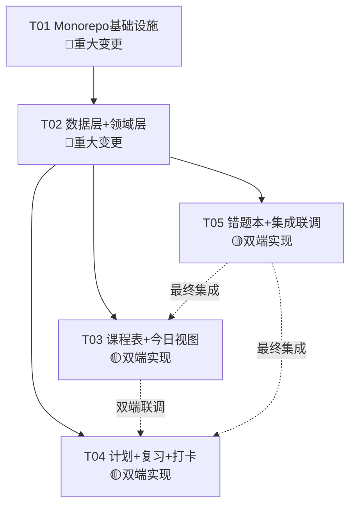

# ARCHITECTURE_DELTA：增量架构设计（双端数据同步方案）

| 项目信息 | 内容 |
| --- | --- |
| 文档版本 | v0.1 |
| 文档角色 | 增量架构设计（基于客户确认的平台与需求变更） |
| 上游输入 | `docs/PRD.md`（v0.1）、`docs/ARCHITECTURE.md`（v0.1） |
| 作者 | 高见远（Architect） |
| 变更摘要 | 平台确定为「小程序（查看端）+ Web 管理后台」；移除多孩子、连续打卡；新增双端数据同步方案对比 |

---

## 一、数据同步方案对比（核心输出）

### 1.1 背景说明

客户确认：
- **目标平台**：小程序（孩子查看端）+ Web 端管理后台（家长操作端）
- **不需要云同步**：理解为不做多设备持续自动同步
- **核心矛盾**：小程序要查看数据，数据必须从某处获取——两端数据如何打通？

以下提供 **3 种方案**，从技术实现、工作量、成本、体验等维度对比。

---

### 方案 A：双端共用云数据库（推荐 ✅）

#### 技术实现简述

```
┌──────────────────┐           ┌──────────────────┐
│   Web 管理后台    │           │   微信小程序      │
│  (家长操作端)     │           │  (孩子查看端)     │
│                  │           │                  │
│  ┌────────────┐  │           │  ┌────────────┐  │
│  │ 云开发 SDK  │  │           │  │ 云开发 SDK  │  │
│  └─────┬──────┘  │           │  └─────┬──────┘  │
│        │         │           │        │         │
└────────┼─────────┘           └────────┼─────────┘
         │                              │
         └──────────┐    ┌──────────────┘
                    ↓    ↓
              ┌──────────────┐
              │  云数据库      │
              │  (单一数据源)  │
              │              │
              │  courses     │
              │  plans       │
              │  checkins    │
              │  mistakes    │
              │  ...         │
              └──────────────┘
```

**技术要点**：
- 使用**微信云开发**（或腾讯云开发）作为统一后端
- Web 端和小程序端共用同一个云数据库
- 任一端写入数据，另一端实时可见（云数据库自带实时推送）
- 无需额外同步逻辑，CRUD 即同步

**具体实现**：
- 原 `data/repositories/` 的 IndexedDB 实现 → 替换为**云数据库实现**
- 保留 `Repository<T>` 接口，新增 `CloudRepository<T>` 实现
- 微信云开发 SDK 支持 Web 端（`wx-server-sdk`）和小程序端（`wx.cloud`）

#### 三维度评估

| 维度 | 评分 | 说明 |
|------|------|------|
| **工作量** | ⭐⭐ 较小（5-8 人天新增） | 原 IndexedDB Repository → CloudRepository 替换；小程序端新增页面但复用领域逻辑 |
| **用户体验** | ⭐⭐⭐⭐⭐ 最佳 | 两端数据实时一致；Web 端新增课程，小程序即时可见；孩子打卡，家长即时看到 |
| **数据一致性** | ⭐⭐⭐⭐⭐ 强 | 单一数据源，天然一致；无冲突合并问题 |
| **是否需要账号体系** | 轻量需要 | 小程序端用微信 openid 静默登录；Web 端可用邀请码/设备绑定（无需独立账号系统）|

#### 开发成本

| 成本项 | 金额/月 |
|--------|---------|
| 云开发基础版 | 免费额度通常够用（单用户场景） |
| 超出后按量 | 读 0.015元/万次，写 0.02元/万次 |
| 预估月费 | **0-20元**（单孩子场景极低） |

#### 推荐场景

✅ **推荐**：希望两端数据实时一致、小程序端也想打卡操作、长期维护
✅ 最适合「家长Web管理 + 孩子小程序查看/打卡」的家庭场景

---

### 方案 B：Web 生成分享链接/二维码，小程序扫码拉取快照

#### 技术实现简述

```
┌──────────────────┐           ┌──────────────────┐
│   Web 管理后台    │           │   微信小程序      │
│                  │  生成链接  │                  │
│  [发布分享] ─────┼──→ 短链   │  [扫码/输入码]    │
│                  │           │       │          │
│  ┌────────────┐  │           │       ↓          │
│  │ IndexedDB  │  │           │  ┌────────────┐  │
│  │ (本地数据)  │  │           │  │ 本地存储    │  │
│  └────────────┘  │           │  │ (快照副本)  │  │
└──────────────────┘           │  └────────────┘  │
         │                     └──────────────────┘
         ↓                            ↑
    生成 JSON 快照 ──→ 临时API ──→ 拉取快照数据
    (含签名/过期时间)
```

**技术要点**：
- Web 端导出当前数据为加密 JSON（含 token + 过期时间）
- 上传至临时存储（可用腾讯云 COS / 云函数临时 KV）
- 生成短链或 6 位分享码
- 小程序扫码/输入码 → 拉取 JSON → 解密 → 存入本地
- **数据是一次性快照**，不自动增量同步；下次需重新扫码

**核心限制**：
- 小程序端数据是「历史快照」，Web 端新增/修改课程后，小程序需重新扫码
- 小程序端**无法实时打卡回传**（或需额外实现反向同步，复杂度高）
- 本质上接近「数据导出导入」

#### 三维度评估

| 维度 | 评分 | 说明 |
|------|------|------|
| **工作量** | ⭐⭐⭐ 中等（8-12 人天） | Web 端导出逻辑 + 临时存储 + 小程序端扫码/解密/存储 |
| **用户体验** | ⭐⭐ 较差 | 每次数据变更需重新扫码；小程序只能看历史快照，打卡无法回传 |
| **数据一致性** | ⭐ 弱 | 快照时间点数据；两端独立，无一致性保障 |
| **是否需要账号体系** | 否 | 用 token + 短链，无需登录 |

#### 适用场景

⚠️ 仅适合「家长把课表一次性分享给老人手机看」这类低频场景
❌ 不适合日常「Web 管理 + 小程序每日查看打卡」的核心场景

---

### 方案 C：Web 为数据源，家长"发布"后小程序镜像可见

#### 技术实现简述

```
┌──────────────────┐           ┌──────────────────┐
│   Web 管理后台    │           │   微信小程序      │
│  (数据源/编辑方)  │           │  (只读镜像)       │
│                  │           │                  │
│  编辑数据        │           │  展示数据         │
│       ↓          │           │       ↑          │
│  [发布] 按钮 ────┼──→ API ──→│  [拉取最新版本]  │
│  (主动推送到云端) │           │  (被动拉取)       │
│                  │           │                  │
│  ┌────────────┐  │           │  ┌────────────┐  │
│  │ 云端数据库  │  │  ──────→  │  │ 本地缓存    │  │
│  │ (发布版)   │  │  云端同步  │  │ (镜像副本)  │  │
│  └────────────┘  │           │  └────────────┘  │
└──────────────────┘           └──────────────────┘
```

**技术要点**：
- 云端存两份数据：Web 的「编辑版」+ 发布后的「快照版」
- 家长点击「发布」→ 将当前数据打包推送到云端「公开区」
- 小程序打开时拉取「公开区」最新数据 → 缓存本地
- **小程序端只读**，不做编辑，打卡数据可选择性地回写到「打卡区」
- 类似「草稿→发布」的内容管理模式

**与方案 A 的区别**：
- 方案 A：Web 写什么，小程序实时看什么（无发布步骤）
- 方案 C：Web 需要主动「发布」，小程序才能看到变更
- 方案 C 给家长更强的控制力（可以反复修改直到满意再发布）

#### 三维度评估

| 维度 | 评分 | 说明 |
|------|------|------|
| **工作量** | ⭐⭐⭐ 中等（10-15 人天） | 需实现「编辑版/发布版」双版本管理 + 发布流程 + 小程序拉取逻辑 |
| **用户体验** | ⭐⭐⭐ 中等 | 家长可控，但孩子可能看到过时数据；需明确提示「数据更新于X天前」|
| **数据一致性** | ⭐⭐ 中等 | 发布后一致，但发布前不一致；需版本标记 |
| **是否需要账号体系** | 半需要 | Web 端可免登录（本地数据），但「发布」到云端需某种身份标识（可用设备ID + token）|

#### 适用场景

⚠️ 适合「家长对展示内容有严格要求，不希望孩子看到半成品数据」
⚠️ 增加了「发布」操作步骤，日常使用可能嫌繁琐

---

## 1.2 方案对比总结表

| 对比项 | 方案 A：共用云数据库 | 方案 B：扫码拉取快照 | 方案 C：发布-镜像 |
|--------|---------------------|---------------------|-------------------|
| **技术实现** | 双端共用云数据库，CRUD 即同步 | Web 导出加密 JSON → 临时存储 → 小程序拉取 | Web「发布」→ 云端快照 → 小程序拉取只读镜像 |
| **预估工作量** | 5-8 人天（新增） | 8-12 人天（新增） | 10-15 人天（新增） |
| **开发成本（月）** | 0-20 元（云开发免费额度） | 0-5 元（COS 极低流量） | 0-20 元（云开发免费额度） |
| **用户体验** | ⭐⭐⭐⭐⭐ 实时一致 | ⭐⭐ 需频繁重新扫码 | ⭐⭐⭐ 需手动发布 |
| **数据一致性** | ⭐⭐⭐⭐⭐ 实时同步 | ⭐ 快照时间点 | ⭐⭐⭐ 发布后一致 |
| **小程序能否打卡** | ✅ 可以，实时回写 | ❌ 不能（单向快照） | ⚠️ 需额外设计回写通道 |
| **是否需要账号体系** | 需轻量登录（微信静默授权） | 否 | 半需要（发布身份标识） |
| **复杂度** | 低（标准 CRUD） | 中（加密 + 短链 + 过期） | 中（双版本 + 发布流程） |
| **后续扩展性** | 好（天然支持多设备/多孩子） | 差 | 中等 |
| **家长管控强度** | 弱（改了就看到） | 强（完全手动分享） | 强（发布才可见） |

---

## 1.3 推荐方案

**🏆 推荐方案 A：双端共用云数据库（微信云开发）**

理由：
1. **工作量最小**（5-8 人天），复用现有 Repository 抽象
2. **体验最佳**：Web 改了，小程序实时看到；小程序打卡，Web 实时显示
3. **成本极低**：单孩子数据量极小，云开发免费额度充足
4. **架构最简**：无需额外「发布」「扫码」流程，降低用户认知负担
5. **扩展性好**：未来若需多孩子/多设备，天然支持

**退路**：若客户后续对「家长管控」有强需求，可在方案 A 基础上加「草稿→发布」UI 层控制，不改底层架构。

---

## 二、基于方案 A 的项目结构建议

### 2.1 小程序端技术栈选择

| 方案 | 优点 | 缺点 | 推荐度 |
|------|------|------|--------|
| **微信原生（推荐✅）** | 性能好、生态原生、云开发集成最佳 | 仅微信、不能跨端 | ⭐⭐⭐⭐⭐ |
| Taro | 可复用 React 代码、跨端 | 小程序端包体积偏大、调试复杂 | ⭐⭐⭐ |
| uni-app | Vue 生态、跨端 | 与现有 React 技术栈不匹配 | ⭐⭐ |

**推荐：微信原生小程序 + 微信云开发**

理由：
- 目标平台明确（小程序 = 微信），无需跨端
- 云开发 SDK 原生集成，`wx.cloud.database()` 直连云数据库
- `miniprogram` 目录独立管理，不影响 Web 端

### 2.2 整体项目结构（Monorepo）

```
courseschedule/
├─ package.json                     # 根 workspace 配置
├─ pnpm-workspace.yaml              # pnpm workspace 声明
├─ tsconfig.base.json               # 共享 TS 基础配置
│
├─ packages/
│  ├─ shared/                       # 🆕 跨端共享包
│  │  ├─ package.json
│  │  ├─ tsconfig.json
│  │  └─ src/
│  │     ├─ domain/                 # 领域模型（类型定义 + 纯函数）
│  │     │  ├─ models.ts            # ✅ 复用自原 src/domain/models.ts
│  │     │  ├─ review/
│  │     │  │  ├─ intervals.ts      # ✅ 复用
│  │     │  │  └─ reviewScheduler.ts # ✅ 复用
│  │     │  ├─ checkin/
│  │     │  │  └─ streak.ts         # ✅ 复用
│  │     │  ├─ schedule/
│  │     │  │  └─ occurrence.ts     # ✅ 复用
│  │     │  └─ today/
│  │     │     └─ todayAggregator.ts # ✅ 复用
│  │     ├─ core/
│  │     │  ├─ constants.ts         # ✅ 复用
│  │     │  └─ utils/
│  │     │     ├─ date.ts           # ✅ 复用
│  │     │     ├─ id.ts             # ⚠️ 适配（nanoid → 小程序兼容）
│  │     │     └─ validation.ts     # ✅ 复用
│  │     ├─ cloud/                  # 🆕 云数据库交互层
│  │     │  ├─ collections.ts       # 集合名常量
│  │     │  ├─ types.ts             # 云函数参数类型
│  │     │  └─ queries.ts           # 通用查询构建辅助
│  │     └─ index.ts                # 统一导出
│  │
│  ├─ web/                          # 🔄 原 Web 端（迁移自 src/）
│  │  ├─ package.json
│  │  ├─ vite.config.ts
│  │  ├─ tsconfig.json
│  │  ├─ tailwind.config.ts
│  │  ├─ index.html
│  │  └─ src/
│  │     ├─ main.tsx
│  │     ├─ App.tsx
│  │     ├─ app/                    # 路由、布局、主题
│  │     ├─ features/               # 5 大功能模块
│  │     ├─ stores/                 # zustand 状态
│  │     ├─ data/
│  │     │  ├─ db.ts                # ⚠️ 改造：IndexedDB → 云数据库优先
│  │     │  ├─ repositories/        # ⚠️ 改造：实现 CloudRepository
│  │     │  └─ cloud/               # 🆕 Web 端云开发 SDK 初始化
│  │     └─ components/             # 共享 UI 组件
│  │
│  └─ miniprogram/                  # 🆕 微信小程序端
│     ├─ package.json
│     ├─ tsconfig.json
│     ├─ project.config.json        # 小程序项目配置
│     ├─ app.json                   # 小程序全局配置
│     ├─ app.ts                     # 小程序入口
│     ├─ app.wxss                   # 全局样式
│     ├─ sitemap.json
│     ├─ pages/
│     │  ├─ today/                  # 首页（今日视图）
│     │  │  ├─ index.wxml
│     │  │  ├─ index.wxss
│     │  │  ├─ index.ts
│     │  │  └─ index.json
│     │  ├─ schedule/               # 课程表
│     │  ├─ plans/                  # 计划（学习+复习）
│     │  ├─ checkin/                # 打卡
│     │  └─ mistakes/               # 错题本
│     ├─ components/                # 小程序自定义组件
│     │  ├─ course-slot/
│     │  ├─ task-card/
│     │  ├─ week-strip/
│     │  ├─ star-burst/            # 打卡动效
│     │  └─ empty-state/
│     ├─ utils/
│     │  ├─ cloud.ts               # 云开发初始化
│     │  └── auth.ts               # 微信登录封装
│     └─ miniprogram_npm/           # npm 构建产物（shared 包）
│
├─ cloudfunctions/                   # 🆕 云函数（微信云开发）
│  ├─ login/                        # 登录（获取 openid）
│  │  ├─ index.js
│  │  └─ package.json
│  ├─ migrate/                      # 数据迁移（可选：本地→云端）
│  │  ├─ index.js
│  │  └─ package.json
│  └─ seed/                         # 初始化种子数据
│     ├─ index.js
│     └─ package.json
│
└─ docs/
   ├─ PRD.md
   ├─ ARCHITECTURE.md
   └─ ARCHITECTURE_DELTA.md         # 本文档
```

### 2.3 共享代码复用策略

| 共享模块 | 复用方式 | 注意事项 |
|----------|----------|----------|
| `domain/models.ts` | 直接复用（TS 类型定义） | 两端共用同一份类型，编译时保证一致性 |
| `domain/review/reviewScheduler.ts` | 直接复用（纯函数） | 无平台依赖，直接可用 |
| `domain/checkin/streak.ts` | 直接复用（纯函数） | 无平台依赖 |
| `domain/schedule/occurrence.ts` | 直接复用（纯函数） | 无平台依赖 |
| `domain/today/todayAggregator.ts` | 直接复用（纯函数） | 无平台依赖 |
| `core/constants.ts` | 直接复用 | 色板/科目/间隔等配置共享 |
| `core/utils/date.ts` | 直接复用 | date-fns 两端均可用 |
| `core/utils/id.ts` | ⚠️ 需适配 | nanoid 在小程序环境需用 `nanoid/non-secure` 或替换为自实现 |
| `data/repositories/` | ❌ 不复用 | Web 用 IndexedDB/云 SDK，小程序用 `wx.cloud.database()`，各自实现 |
| `stores/` | ❌ 不复用 | Web 用 zustand，小程序用 Page data + 云函数 |
| `features/` | ❌ 不复用 | 两端 UI 框架不同，各自实现 |

### 2.4 云数据库集合设计（微信云开发）

```typescript
// cloud/collections.ts
export const COLLECTIONS = {
  CHILDREN: 'children',           // 孩子档案
  COURSES: 'courses',             // 课程定义
  SCHEDULE_RULES: 'scheduleRules', // 排课规则
  LEARNING_PLANS: 'learningPlans', // 学习计划
  PLAN_TASKS: 'planTasks',        // 计划任务
  REVIEW_ITEMS: 'reviewItems',    // 学习内容
  REVIEW_TASKS: 'reviewTasks',    // 复习任务
  CHECKIN_RECORDS: 'checkinRecords', // 打卡记录
  MISTAKES: 'mistakes',           // 错题
  IMAGES: 'images',               // 图片（云存储 fileID）
} as const;
```

**图片存储策略变更**：
- 原方案：图片存 IndexedDB Blob
- 新方案：图片上传至云存储（`wx.cloud.uploadFile`），数据库只存 `fileID`
- Mistake 模型的 `imageIds: string[]` 改为 `imageFileIds: string[]`

### 2.5 Web 端技术栈（基于方案 A 调整）

**复用当前设计**，仅数据层改造：

| 层级 | 原方案 | 方案 A 调整后 |
|------|--------|---------------|
| 状态管理 | zustand（本地） | zustand（本地 + 云端同步） |
| 数据持久化 | IndexedDB（idb） | **云数据库优先** + IndexedDB 离线缓存 |
| Repository | IndexedDB 实现 | **CloudRepository 实现**（wx.cloud 或 Web SDK） |
| 图片存储 | IndexedDB Blob | 云存储（COS） |

**Web 端云开发 SDK**：
```typescript
// web/src/data/cloud/init.ts
import wxCloud from 'wx-server-sdk'; // 或 web 端用 cloudbase-js-sdk

export const cloud = wxCloud.init({
  env: 'your-env-id',
});
```

---

## 三、移除项清单

### 3.1 需移除的需求/功能

| 原编号 | 原需求 | 处理 | 原因 |
|--------|--------|------|------|
| P1-1 | 多孩子支持 | ❌ **移除** | 客户确认「暂不支持多孩子」 |
| P1-5 | 成就激励（里程碑徽章） | ❌ **移除** | 依赖「连续打卡」，客户确认「不需要连续打卡」 |
| P2-3 | 数据云同步与多设备 | ⚠️ **重新定义** | 不是「多设备同步」而是「双端数据打通」，按方案 A 实现 |
| P2-5 | 家长/孩子双账号权限 | ❌ **移除** | 单设备双模式已足够，小程序端用分享链接控制访问 |

### 3.2 需简化的数据模型

| 模型/字段 | 原设计 | 简化后 | 说明 |
|-----------|--------|--------|------|
| `BaseEntity.childId` | 必填，为多孩子预留 | ✅ **保留** | 云端数据必须有归属标识，但固定为默认值 |
| `ChildProfile` | 支持多档案 | ⚠️ **简化** | 仅保留一条默认档案，无切换功能 |
| `CheckInRecord.isMakeup` | 支持当日补卡 | ⚠️ **重新评估** | 客户说「不需要连续打卡」，需确认是否保留打卡功能本身 |
| streak 计算 | 连续打卡天数 | ⚠️ **重新评估** | 若无连续打卡需求，streak 改为「累计打卡天数」或移除 |
| `data/sync/` | 预留空目录 | 🆕 **实现** | 按方案 A 实现 CloudRepository |

### 3.3 需移除的文件/组件

| 文件 | 处理 | 说明 |
|------|------|------|
| `src/features/checkin/Milestones.tsx` | ❌ 移除 | 里程碑徽章依赖连续打卡 |
| `src/features/schedule/MonthView.tsx` | ⏸️ 保留占位 | 月视图是 P1-6，与本次变更无关，可保留 |
| `src/data/repositories/childRepository.ts` | ⚠️ 简化 | 仅保留 getDefault() 方法，无列表/切换 |
| `src/stores/useAppStore.ts` 中 `childId` | ⚠️ 简化 | 固定为 DEFAULT_CHILD_ID，无切换逻辑 |

### 3.4 需移除的共享知识条目

| 原约定 | 处理 |
|--------|------|
| 「childId = 所有查询必带」 | 保留但内部常量固定，UI 层不暴露 |
| 「连击规则：streak 计算」 | 重新定义或移除（见下方打卡语义澄清） |

---

## 四、打卡语义澄清

客户说「不需要连续打卡」，需澄清两个概念：

| 概念 | 原设计 | 客户意图 | 处理 |
|------|--------|----------|------|
| **打卡功能本身** | ✅ P0-6/P0-7 | ✅ **保留** | 任务完成确认 + 累计统计 |
| **连续打卡天数（streak）** | 连续 N 天不间断 | ❌ **移除** | 不强调「连续」，改为「累计完成 X 次」 |
| **里程碑徽章** | 7/21/100 天连续 | ❌ **移除** | 依赖连续概念 |

**调整后的打卡统计**：
- ~~连续打卡天数~~ → **累计打卡天数**（总共完成了多少个任务日）
- 本周打卡日历：保留（可视化哪些天有打卡，不强调连续性）
- 今日完成率：保留

---

## 五、更新后的任务列表 T01–T05

### 影响标注说明

- 🟢 **不受影响**：按原计划执行
- 🟡 **部分调整**：需小幅修改
- 🔴 **重大变更**：需重新设计
- 🆕 **新增任务**：原计划无

---

### T01：项目基础设施（Monorepo + 双端骨架）🔴 重大变更

**原任务**：Web 单端基础设施
**变更后**：Monorepo 基础设施 + 小程序骨架

**文件**：
```
根目录：
├─ package.json                     # pnpm workspace 配置
├─ pnpm-workspace.yaml              # 🆕
├─ tsconfig.base.json               # 🆕 共享 TS 基础配置

packages/shared/：
├─ package.json                     # 🆕
├─ tsconfig.json                    # 🆕
└─ src/index.ts                     # 🆕 统一导出

packages/web/：
├─ package.json                     # 🆕（迁移自根 package.json）
├─ vite.config.ts                   # 🟡（路径调整）
├─ tsconfig.json                    # 🟡
├─ tailwind.config.ts               # 🟡
├─ index.html                       # 🟡
└─ src/
   ├─ main.tsx                      # 🟢
   ├─ App.tsx                       # 🟢
   ├─ app/*                         # 🟢
   └─ core/constants.ts             # 🟢

packages/miniprogram/：
├─ package.json                     # 🆕
├─ project.config.json              # 🆕
├─ app.json                         # 🆕
├─ app.ts                           # 🆕
└─ pages/（5个页签骨架）              # 🆕
```

**内容**：
- 初始化 pnpm monorepo
- 搭建 shared 包（类型定义 + 纯函数）
- Web 端迁移至 packages/web，保持原有结构
- 小程序端初始化，5 个页签骨架 + TabBar 配置
- MUI 主题、Tailwind、路由等保持原设计

**依赖**：无
**验收**：
- `pnpm install` 成功
- `pnpm --filter web dev` Web 端正常启动
- 小程序开发者工具导入 packages/miniprogram 可预览

---

### T02：数据层 + 领域层（云数据库 + 纯函数共享）🔴 重大变更

**原任务**：IndexedDB + 领域层
**变更后**：云数据库 Repository + 领域层共享

**文件**：
```
packages/shared/src/：
├─ domain/
│  ├─ models.ts                     # 🟢 原样复用
│  ├─ review/intervals.ts           # 🟢
│  ├─ review/reviewScheduler.ts     # 🟢
│  ├─ checkin/streak.ts             # 🟡 移除连续天数，改累计
│  ├─ schedule/occurrence.ts        # 🟢
│  └─ today/todayAggregator.ts      # 🟢
├─ core/
│  ├─ constants.ts                  # 🟢
│  └─ utils/
│     ├─ date.ts                    # 🟢
│     ├─ id.ts                      # 🟡 适配小程序环境
│     └─ validation.ts              # 🟢
└─ cloud/
   ├─ collections.ts                # 🆕
   ├─ types.ts                      # 🆕
   └─ queries.ts                    # 🆕

packages/web/src/data/：
├─ db.ts                            # 🔴 重写为云数据库初始化
├─ cloud/
│  └─ init.ts                       # 🆕 Web 端云 SDK
└─ repositories/
   ├─ base.ts                       # 🔴 CloudRepository 基类
   ├─ courseRepository.ts           # 🔴 云数据库实现
   ├─ scheduleRuleRepository.ts     # 🔴
   ├─ planRepository.ts             # 🔴
   ├─ reviewRepository.ts           # 🔴
   ├─ checkinRepository.ts          # 🔴
   ├─ mistakeRepository.ts          # 🔴
   └─ imageRepository.ts            # 🔴 改为云存储

cloudfunctions/：
├─ login/index.js                   # 🆕
├─ seed/index.js                    # 🆕 种子数据
└─ migrate/index.js                 # 🆕（可选）
```

**内容**：
- shared 包导出领域模型 + 纯函数（两端复用）
- Web 端 CloudRepository 实现（替代 IndexedDB）
- 云函数：登录（获取 openid）、种子数据初始化
- 云数据库集合设计实现
- 图片改用云存储

**依赖**：T01
**验收**：
- 云数据库集合创建成功
- Web 端 CRUD 操作云端数据正常
- 小程序端可读取云端数据
- shared 包纯函数测试通过

---

### T03：课程表 + 今日视图（双端实现）🟡 部分调整

**Web 端**：🟢 基本不受影响
**小程序端**：🆕 新增实现

**文件**：
```
packages/web/src/features/schedule/： # 🟢 原样
packages/web/src/features/today/：    # 🟢 原样
packages/web/src/stores/useScheduleStore.ts： # 🟡 改用 CloudRepository

packages/miniprogram/pages/schedule/： # 🆕
├─ index.wxml
├─ index.wxss
├─ index.ts
└─ index.json

packages/miniprogram/pages/today/：   # 🆕
├─ index.wxml
├─ index.wxss
├─ index.ts
└─ index.json

packages/miniprogram/components/：
├─ course-slot/                       # 🆕
├─ task-card/                         # 🆕
└─ week-strip/                        # 🆕
```

**内容**：
- Web 端：课程表 CRUD + 今日视图（原设计）
- 小程序端：课程表展示（只读）+ 今日视图
- 小程序端使用 shared 包的 occurrence.ts、todayAggregator.ts

**依赖**：T01、T02
**验收**：
- Web 端添加课程后，小程序端实时可见
- 两端今日视图数据一致

---

### T04：学习计划 + 复习计划 + 打卡（双端实现）🟡 部分调整

**文件**：
```
packages/web/src/features/plans/：    # 🟢 原样
packages/web/src/features/checkin/：  # 🟡 移除 Milestones
packages/web/src/stores/：            # 🟡 改用 CloudRepository

packages/miniprogram/pages/plans/：   # 🆕
packages/miniprogram/pages/checkin/： # 🆕
packages/miniprogram/components/：
└─ star-burst/                        # 🆕 打卡动效
```

**内容**：
- Web 端：计划 CRUD + 复习计划 + 打卡（原设计，移除里程碑）
- 小程序端：计划查看 + 打卡操作（实时同步到云端）
- 打卡统计改为「累计打卡天数」（移除连续天数）

**依赖**：T01、T02
**验收**：
- Web 端录入学习内容 → 小程序端可见复习任务
- 小程序端打卡 → Web 端实时显示完成状态

---

### T05：错题本 + 集成联调（双端实现）🟡 部分调整

**文件**：
```
packages/web/src/features/mistakes/： # 🟢 原样（图片改云存储）
packages/web/src/stores/useMistakeStore.ts： # 🟡
packages/web/src/components/：        # 🟢

packages/miniprogram/pages/mistakes/： # 🆕
packages/miniprogram/components/：
└─ empty-state/                       # 🆕

集成联调：
├─ 端到端数据流验证                    # 🆕
└─ 移动端适配收尾                      # 🟡
```

**内容**：
- Web 端：错题录入（图片上传云存储）+ 筛选浏览
- 小程序端：错题查看（只读）
- 双端集成联调：全链路数据同步验证
- 移动端适配收尾

**依赖**：T01、T02
**验收**：
- Web 端录入带图错题 → 小程序端可查看图片
- 错题加入复习计划 → 双端同步
- 全链路数据一致性验证通过

---

## 5.1 更新后的任务依赖图



---

## 5.2 任务影响汇总表

| 任务 | 原状态 | 变更后 | 主要差异 |
|------|--------|--------|----------|
| T01 | Web 单端 | 🔴 Monorepo + 小程序骨架 | 新增小程序项目、pnpm workspace、shared 包 |
| T02 | IndexedDB + 领域层 | 🔴 云数据库 + 领域共享 | 数据层重写、领域层抽取到 shared、云函数 |
| T03 | Web 课程表+今日 | 🟡 双端实现 | Web 端基本不变，新增小程序端页面 |
| T04 | Web 计划+打卡 | 🟡 双端实现 | 移除里程碑、打卡统计改累计、新增小程序端 |
| T05 | Web 错题本 | 🟡 双端+集成 | 图片改云存储、新增小程序端、集成联调范围扩大 |

---

## 六、补充说明

### 6.1 关于「微信登录」

方案 A 需要轻量级登录：
- 小程序端：`wx.login()` 获取 code → 云函数换取 openid → 作为 `childId` 的关联标识
- Web 端：可选微信开放平台扫码登录，或使用设备 ID + 邀请码绑定
- **简化方案**：首发可不做 Web 端登录，Web 端数据直接写云数据库（匿名身份），小程序端通过 openid 识别用户

### 6.2 关于「离线使用」

云数据库方案下，离线场景需额外处理：
- 方案 A 简化版：小程序端首次打开缓存数据到本地 Storage，离线时展示缓存（只读）
- 后续优化：引入本地缓存 + 联网同步机制（类似原 ARCHITECTURE.md 的 IndexedDB + 云同步设计）

### 6.3 关于「数据迁移」

若已有 IndexedDB 数据需迁移到云端：
- 提供 `cloudfunctions/migrate` 云函数
- Web 端「数据迁移」按钮：读取本地 IndexedDB → 批量写入云数据库
- 一次性操作，迁移完成后可清除本地数据

---

## 附：决策记录

| 决策 | 选择 | 理由 |
|------|------|------|
| 数据同步方案 | 方案 A（共用云数据库） | 工作量最小、体验最佳、成本极低 |
| 小程序技术栈 | 微信原生 | 目标平台明确，云开发集成最佳 |
| 项目管理 | pnpm Monorepo | 共享代码、统一依赖、独立构建 |
| 连续打卡 | 移除 | 客户明确不需要 |
| 多孩子 | 移除 | 客户明确暂不支持 |
| 图片存储 | 云存储 | 双端共享访问，IndexedDB 不适合 |

---

*文档版本：v0.1 | 作者：高见远（架构师）| 上游：PRD v0.1 + ARCHITECTURE v0.1*
